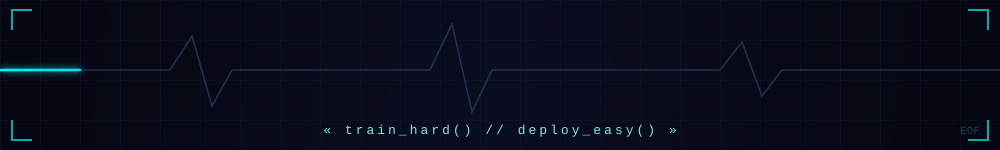

<!-- GitHub profile README — Muh Al Haikal (NIM 105841118623) -->
<div align="center">



[+...+%5BOK%5D;%3E+while+alive%3A+learn()%2C+build()%2C+ship())](https://github.com/Ekalyptuss)


[](https://github.com/Ekalyptuss?tab=followers)

[](https://github.com/Ekalyptuss)
[](https://orcid.org/0009-0009-8599-8909)
[](https://www.scopus.com/authid/detail.uri?authorId=61056197200)
[](https://www.linkedin.com/in/muh-al-haikal-3b48b8447)


</div>

## <samp>RESEARCH_PROFILE — abstract.txt</samp>

Research-oriented **Computer Science** undergraduate at **Universitas Muhammadiyah Makassar** working at the
intersection of **artificial intelligence, cybersecurity, and interdisciplinary data science**. I apply machine
learning (Random Forest, DBSCAN, Isolation Forest, PCA) to intrusion detection and IP reputation scoring for edge
firewalls, climate-driven disease outbreak detection, agroclimatic risk zoning, and spatio-temporal environmental
analysis. Next goal: a **Master's degree in Informatics in Australia**.

### 📄 Publications

| Year | Paper | Venue |
|---|---|---|
| 2026 | [Data-driven agroclimatic risk zoning for maize cultivation in Indonesia using long-term daily climate indicators](https://doi.org/10.19101/IJATEE.2026.131340640) | *Int. J. of Advanced Technology and Engineering Exploration* (Scopus) |
| 2026 | [Climate-Driven Disease Outbreak Anomaly Detection Using PCA, DBSCAN, and Isolation Forest](https://doi.org/10.30736/jti.v11i02.1674) | *Joutica* |

More manuscripts are under review in Scopus-indexed Q1/Q2 journals.

### 🔬 Research Lines

- **Cybersecurity:** intrusion detection & IP reputation scoring for edge firewalls (Random Forest + DBSCAN, simulation-based evaluation)
- **Climate & public health:** unsupervised anomaly detection for climate-driven dengue surveillance
- **Environmental data science:** spatio-temporal analysis of particulate matter exposure across Indonesian provinces, agroclimatic risk zoning

### 🏆 Honors & Certifications

- 🥇 **Overall Champion (Rank 1)** for three consecutive academic years
- 🥉 **3rd Place**, national Story Telling Competition *"Perkembangan Industri 4.0 Era Milenial"*, Orbit Ilmiah XI
- 🛩️ **Technical Competency Certification**, Airframe & Powerplant, Wing 5 Lanud Sultan Hasanuddin, Skadron Udara 5

## <samp>NEURAL_CORE — whoami.py</samp>

<table>
<tr>
<td valign="top">

```python
import torch.nn as nn

class MuhAlHaikal(nn.Module):
    """Human. Learns fast. Occasionally overfits on coffee. ☕"""

    def __init__(self):
        super().__init__()
        self.alias      = "haikal"
        self.nim        = "105841118623"
        self.university = "Universitas Muhammadiyah Makassar"
        self.base       = "Makassar, Indonesia 🇮🇩"
        self.focus      = ["Artificial Intelligence", "Cybersecurity", "Data Science"]
        self.research   = ["Intrusion Detection", "Climate & Health Anomalies", "Spatio-temporal Analysis"]
        self.side_quest = ["Web Development", "Cloud Computing"]

    def forward(self, coffee, data):
        knowledge = self.backprop(data)        # epochs = ∞, patience = high
        return self.ship(knowledge * coffee)   # deploy > perfect


haikal = MuhAlHaikal()
haikal.train()   # ⚠️ permanently stuck in training mode
```

</td>
<td width="400" align="center" valign="middle">



<sub><samp>&gt; biometric_scan.exe — identity verified ✓</samp></sub>

</td>
</tr>
</table>

<div align="center">
<table>
<tr>
<td>

```text
███████╗██╗  ██╗ █████╗ ██╗     ██╗   ██╗██████╗ ████████╗██╗   ██╗███████╗
██╔════╝██║ ██╔╝██╔══██╗██║     ╚██╗ ██╔╝██╔══██╗╚══██╔══╝██║   ██║██╔════╝
█████╗  █████╔╝ ███████║██║      ╚████╔╝ ██████╔╝   ██║   ██║   ██║███████╗
██╔══╝  ██╔═██╗ ██╔══██║██║       ╚██╔╝  ██╔═══╝    ██║   ██║   ██║╚════██║
███████╗██║  ██╗██║  ██║███████╗   ██║   ██║        ██║   ╚██████╔╝███████║
╚══════╝╚═╝  ╚═╝╚═╝  ╚═╝╚══════╝   ╚═╝   ╚═╝        ╚═╝    ╚═════╝ ╚══════╝

>      mounting /dev/coffee ...... [ OK ] ☕ mandatory daily fuel
```

</td>
</tr>
</table>
</div>

## <samp>NEURAL_STACK</samp>

### 🤖 AI / Machine Learning

[](https://skillicons.dev)


### 💻 Web & Software

[](https://skillicons.dev)

### 🗄️ Data & Tools

[](https://skillicons.dev)


## <samp>AI_LAB — experiment_logs</samp>

| 🧪 Experiment | 📋 Mission Log | 🛠️ Arsenal |
|---|---|---|
| [🧠 DeepLearningSleepGuardAI](https://github.com/Ekalyptuss/DeepLearningSleepGuardAI) | Real-time drowsiness detection powered by CNN | Python · TensorFlow · OpenCV |
| [⚡ UNISMUH-ComputeHub](https://github.com/Ekalyptuss/UNISMUH-ComputeHub) | High-Performance Computing platform for Informatics | Python |

## <samp>TELEMETRY — live_metrics</samp>

<div align="center">


</div>

## <samp>BOMBERMAN_PROTOCOL</samp>

<div align="center">

<picture>
  <source media="(prefers-color-scheme: dark)" srcset="https://raw.githubusercontent.com/Ekalyptuss/Ekalyptuss/output/bomberman-contribution-graph-dark.svg" />
  <source media="(prefers-color-scheme: light)" srcset="https://raw.githubusercontent.com/Ekalyptuss/Ekalyptuss/output/bomberman-contribution-graph.svg" />
  
</picture>

<br/><br/>



</div>
